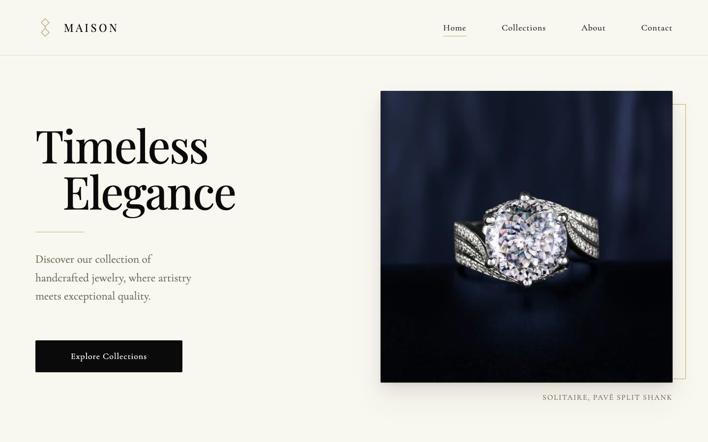

# MAISON — free Astro template for jewelers

A calm, editorial catalogue site for jewelers, ateliers and bespoke studios: fifteen pieces with
long-form product pages, a filterable collection, and almost no JavaScript.

**Live demo:** https://fpsjago.github.io/jeweler-store-astro/



Free and open source under the MIT license. Made by **[FSEVO — Full Stack Evolved](https://www.fullstackevolved.com/?utm_source=template&utm_medium=readme&utm_campaign=maison)**.

---

## Features

- **A hero that moves on its own terms.** The headline rises line by line, a gold rule draws in,
  and a cream curtain lifts off the photograph. On scroll the photo, its frame and the copy drift
  at three different rates. Pure CSS: scroll-driven animations with a still fallback.
- **Scroll reveals in CSS.** Sections rise into view through `animation-timeline: view()`. No
  observer scripts, and text never fades, so contrast stays valid at every frame.
- **Smooth collection filter.** Cards glide to their new places through the View Transitions API,
  with an announced result count for screen readers.
- **Shared-element page transitions.** A product photo morphs from the grid into its detail page
  (Astro `ClientRouter`).
- **Content collections.** Each product is a Markdown file with a validated schema. A typo in a
  field fails the build with a clear message instead of shipping a broken page.
- **Fast by default.** Responsive AVIF and WebP for every photo, a preloaded hero image,
  self-hosted variable fonts with metric-matched fallbacks. Lighthouse scores 100 for performance
  and accessibility on desktop and mobile across all 20 pages (measured on the production build).
- **Accessible.** WCAG AA colour tokens, skip link, visible focus rings, `aria-current`
  navigation, keyboard-reachable everything, and `prefers-reduced-motion` respected throughout.
- **Real enquiry flow.** "Request Information" and "Schedule Viewing" open the contact form with
  the piece already filled in. The form confirms inline; wire it to any form backend.
- **Subpath-safe.** Every link is built from `BASE_URL`, so it deploys to a GitHub Pages subpath
  or your own domain unchanged. A 404 page is included.

## Stack

| Package | Version |
|---|---|
| `astro` | 7.4 |
| `@astrojs/check` | 0.9 |
| `typescript` | 5.9 |

No UI framework and no CSS framework. Styling is scoped `<style>` in each `.astro` file plus one
global block of design tokens. Client JavaScript is Astro's router and three small scripts
(menu, filter, contact form).

**Node 22.22 or newer** is required (Astro 7's own floor).

## Quick start

```bash
npm install
npm run dev        # http://localhost:4321/jeweler-store-astro/
npm run build      # type-check (astro check) + static build into dist/
npm run preview    # serve the production build
```

The `/jeweler-store-astro/` part of the URL comes from the `base` option in `astro.config.mjs`,
set for GitHub Pages. Remove it when you deploy to your own domain (see `DEPLOYMENT.md`).

## Pages

| Route | What it is |
|---|---|
| `/` | Hero, four featured pieces, values, story |
| `/collections/` | All pieces with a category filter |
| `/products/<slug>/` | One page per Markdown file in `src/content/products/` (15 included) |
| `/about/` | Heritage story, principles, numbers |
| `/contact/` | Visit details and an enquiry form |
| `/404` | Not-found page |

## Make it yours

Start with `CUSTOMIZATION.md`. The short version:

- **Colours and spacing** are tokens at the top of the global style block in
  `src/layouts/BaseLayout.astro`.
- **Fonts** are configured in `astro.config.mjs` and live in `src/assets/fonts/`.
- **Products** are Markdown files in `src/content/products/`; the filename is the URL.
- **Photos** go in `src/assets/`, named after the product, and are registered once in
  `src/lib/product-images.ts`.
- **Deploying** to GitHub Pages, Netlify or Vercel is covered in `DEPLOYMENT.md`.

This is a catalogue, not a shop: prices are display text and there is no cart. `CUSTOMIZATION.md`
lists simple ways to add checkout (Snipcart, Shopify Buy Button, Stripe Payment Links).

## More templates

Looking for another niche or style? Browse the full collection at
**[fullstackevolved.com/templates](https://www.fullstackevolved.com/templates/)**.

## License

Code: [MIT](LICENSE.md), Copyright 2026 FULLSTACK EVOLVED LLC. Demo photographs are from Pexels
and fonts are under the SIL Open Font License; both keep their own terms, listed in
`IMAGE-CREDITS.md`. Replace the demo photos with your own before launch.
